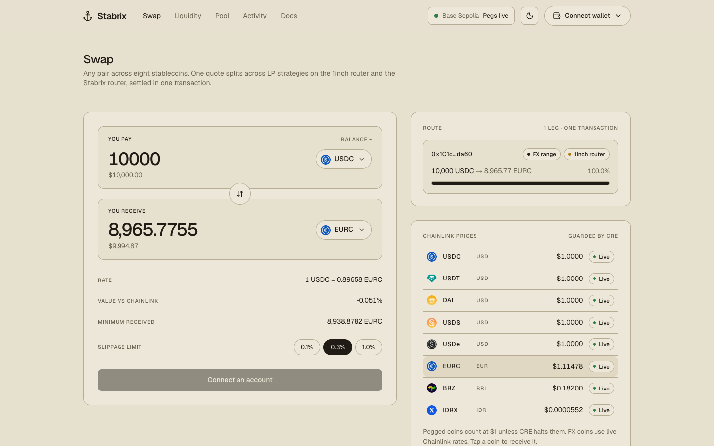
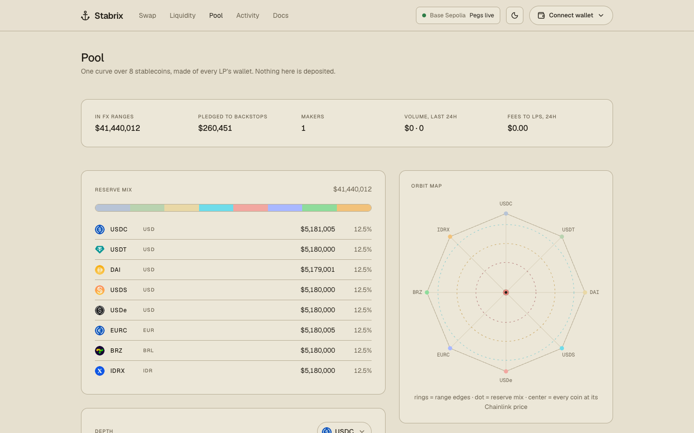
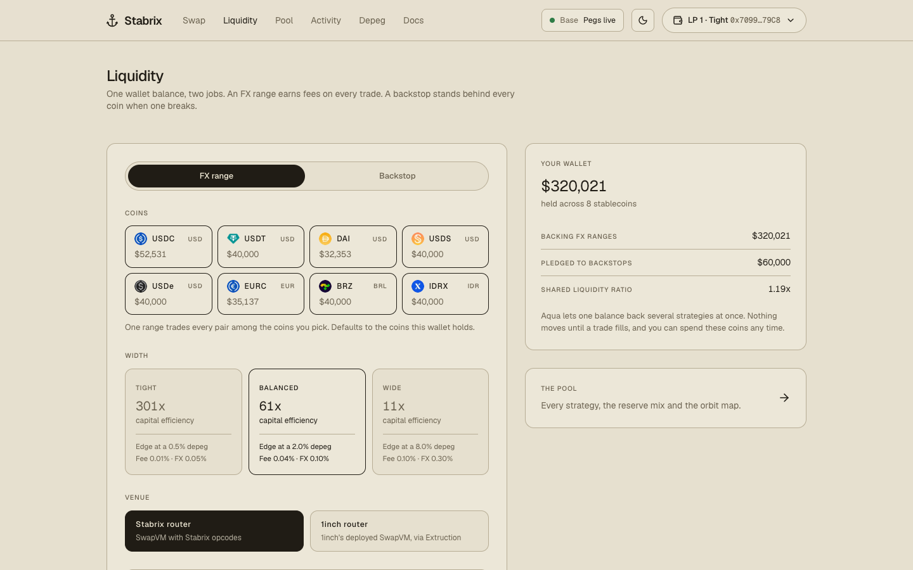
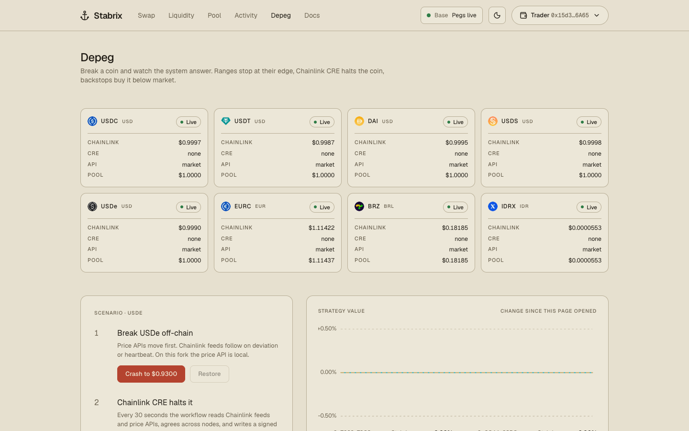
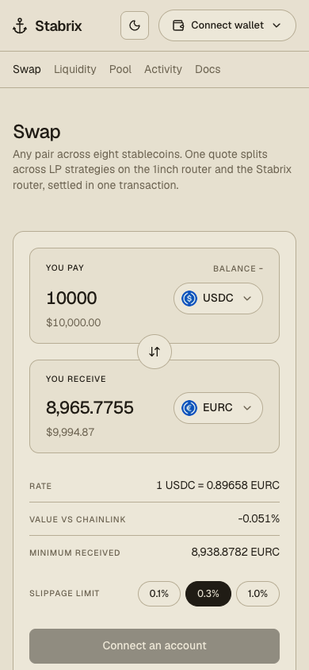

# Stabrix

**Liquidity that never leaves.** One wallet balance makes stablecoin FX markets on 1inch Aqua and backs every stablecoin when one breaks, priced and guarded by Chainlink CRE.


| Swap, live on Base Sepolia | Pool, live on Base Sepolia |
|---|---|
|  |  |
| **Liquidity, Base mainnet fork** | **Depeg, Base mainnet fork** |
|  |  |

The swap quotes $10,000 USDC for 8,965.78 EURC in one leg on 1inch's router, 5.13 bps under the Chainlink rate with the FX fee. The pool holds $41.4M of test coins in FX ranges and $260k pledged to backstops, all still in one wallet.

| Mobile |  |
|---|---|
|  |  |

## What it does

Stablecoins in wallets and treasuries earn nothing, because earning swap fees means locking them in a pool. When one coin depegs, LPs in that pool end up holding it.

Stabrix gives a wallet two jobs at once, without moving its coins:

1. **FX range** (SwapVM opcode 34, `StabrixTick`). One Aqua strategy prices up to 8 stablecoins on one curve: USDC, USDT, DAI, USDS and USDe at $1, plus EURC, BRZ and IDRX at live euro, real and rupiah rates. The math comes from Paradigm's research paper on AMMs for many stablecoins, built as a closed-form SwapVM instruction with one square root per swap. Every swap re-derives the pool from live Aqua balances and reverts if the LP's position would lose value.
2. **Peg backstop** (SwapVM opcode 35, `StabrixBackstop`). Dormant while every coin is healthy. When Chainlink CRE halts a coin, the backstop buys it at its market price minus a discount the LP chooses, pays in healthy coins, and never pays above face value.

The same balance backs both strategies, because Aqua only records allowances and pulls tokens when a trade fills. LPs can still spend their coins; the router routes around a wallet that no longer holds what it offered.

**Chainlink CRE** runs the pricing and the safety. Every 30 seconds a Go workflow reads Chainlink feeds and two price APIs in one batched call, agrees on prices across nodes, and writes signed FX rates and depeg halts to `StabrixOracle`.

## How it fits together

```
 app (Next.js)  ->  @stabrix/sdk (viem): market snapshot, quotes, split, ship, dock
        |
        +-- StabrixBatchTaker: one trade, many makers, both routers, one transaction
              |                                   |
     StabrixRouter (SwapVM v1.0.2)       1inch AquaSwapVMRouter (official)
     opcode 34 StabrixTick                Extruction -> StabrixExtruction
     opcode 35 StabrixBackstop            Extruction -> StabrixBackstop
              |                                   |
              +---- StabrixPricing / StabrixBackstopPricing ----+
                     reads Aqua balances, checks the maker's wallet, asks the oracle
                                          |
              1inch Aqua (official) <- maker wallets       StabrixOracle <- Chainlink CRE workflow
                                                                 ^            (feeds + 2 APIs, Go)
                                                         Chainlink feeds
```

## Track: 1inch, Build an Aqua App

| What | Where |
|---|---|
| Aqua strategies, no deposits | Ranges and backstops are shipped to the official Aqua `0x1111113CCf1426A8E30e2bfF5E005d929bF6a90a`; fills pull from the maker wallet (`sdk/src/client.ts`, `contracts/src/StabrixLens.sol`) |
| New SwapVM instructions | `StabrixTick` (34) and `StabrixBackstop` (35) in `contracts/src/StabrixRouter.sol`; pricing in `StabrixPricing.sol`, `StabrixMath.sol`, `StabrixBackstopPricing.sol` |
| Official router | The same pricing runs on 1inch's AquaSwapVMRouter `0x111111338c5091E8440b67B168bAe16a668AC0De` through Extruction (`StabrixExtruction.sol`, `StabrixBackstop.sol`) |
| Shared liquidity | One wallet backs an FX range and a backstop at once; the Liquidity page shows the shared liquidity ratio |
| Multi-token strategies | One strategy covers 8 coins and 56 swap directions; configs are packed to fit SwapVM's 255-byte instruction argument (`StabrixConfig.sol`, `StabrixBackstopConfig.sol`) |
| Real contracts, real tokens | `contracts/test/fork/BaseFork.t.sol` fills every pair on the official router with real EURC, BRZ and IDRX on a Base mainnet fork |

## Track: Chainlink, Best workflow with CRE

| What | Where |
|---|---|
| Workflow | `cre/depeg-sentinel/main.go` (cron, one Multicall3 read, two HTTP fetches with consensus, report, EVM write) |
| Policy | `cre/depeg-sentinel/policy.go`: 3% off peg halts, both sources past 0.75% halt, a halted coin resumes once every source that answered is back inside 0.25%, so one lagging API cannot lift a halt. An offchain halt needs every configured API to agree; a Chainlink feed can halt alone. FX rates push on a 2 bp move or every 10 minutes |
| Consumer | `contracts/src/StabrixOracle.sol`: accepts reports only from the forwarder and the set workflow owner, uses a CRE rate only if fresh and within 0.5% of the Chainlink feed, refuses swaps on a stale feed, keeps guardian halts separate |
| Simulation | Run against the fork and a Base Sepolia fork with `--broadcast`; the reports change prices and halts onchain |

## Prize requirements, checked

**1inch, Build an Aqua App**

| Requirement | Status | Evidence |
|---|---|---|
| Custom Aqua app with a sophisticated DeFi position | Done | FX ranges over up to 8 coins and peg backstops, shipped as Aqua strategies from one wallet (`contracts/src`, Liquidity page) |
| Uses SwapVM, own instructions allowed | Done | Two new instructions, `StabrixTick` (34) and `StabrixBackstop` (35), in `contracts/src/StabrixRouter.sol` |
| Positions shown through tests or a UI | Done | 80 Foundry tests and the Liquidity, Pool and Activity pages |
| Official Aqua and SwapVM contracts (modified SwapVM redeploy allowed) | Done | Official Aqua `0x1111113C...a90a` and AquaSwapVMRouter `0x111111338c...C0De` on Base; our router is SwapVM v1.0.2 with two added instructions. `contracts/test/fork/BaseFork.t.sol` |
| Onchain token transfers in the demo (local forks ok) | Done | Live on Base mainnet with real USDC and EURC on the official Aqua and router (seed txs below); live swaps and a backstop depeg sale on Base Sepolia (`docs/evidence/sepolia-costs.txt`, `docs/evidence/sepolia-depeg.txt`); swaps, range and backstop fills on the Base fork through the app, quotes equal to the chain to the wei |
| Proper git history | Ongoing | Small commits per change; keep committing through the final day |

**Chainlink, Best workflow with CRE**

| Requirement | Status | Evidence |
|---|---|---|
| CRE workflow used as the orchestration layer | Done | `cre/depeg-sentinel` sets FX rates and depeg halts that every swap reads through `StabrixOracle` |
| Blockchain plus an external API or data source | Done | Base (Multicall3 reads of Chainlink feeds and oracle state, signed report writes) plus CoinGecko and DefiLlama with median consensus |
| Successful simulation with the CRE CLI, or a live deployment | Done | `docs/evidence/cre-simulate-halt.txt` (USDe halted at $0.93, tx `0xa023...8cf7`) and `docs/evidence/cre-simulate-resume.txt` (resumed, tx `0xcd39...15a1ee`); and `docs/evidence/cre-simulate-sepolia.txt` on Base Sepolia itself (tx `0x9b38...7e77`) |
| Meaningfully used | Done | Halted coins are refused by every range on both routers and only backstops buy them; FX swaps price at the CRE rate |

## Measured

All on a Base mainnet fork with real tokens and both 1inch routers, unless noted.

| | Result |
|---|---|
| $10,000 USDC to DAI, live on Base Sepolia from a fresh wallet | 9,998.88 DAI, 1.12 bps with the fee, equal to the quote: [0xe8c89fee...3003](https://sepolia.basescan.org/tx/0xe8c89fee79fec9cb8daaa142a622a409e00c1d579c22ed34b7968109bfd63003) |
| $10,000 USDC to EURC, live on Base Sepolia | 8,965.68 EURC, 5.24 bps with the FX fee: [0x02cb7a18...895d](https://sepolia.basescan.org/tx/0x02cb7a187e5521a770386bb79b6ec95bcb15109785a4494c2e6c2e586dc5895d) |
| Base Sepolia cost table (`npm run costs`), measured Nov 7 | USD to USD: 1.03 / 1.14 / 2.23 bps at $1k / $10k / $100k. USD to EUR: 5.02 / 5.13 / 6.22 bps. One leg each, fees included. Log in `docs/evidence/sepolia-costs.txt` |
| Base mainnet, real money | $1.70 of USDC and EURC backs $3.74 of strategies on both 1inch routers, a shared liquidity ratio of 2.20x; the full deploy cost 0.0000656 ETH (about $0.15) |
| Depeg on Base Sepolia (`npm run depeg:testnet`) | Guardian halts test USDe at $0.93, every range refuses it, a fresh wallet sells 5,000 USDe to two backstops (one per router) for 4,549.25 USDC: [0x01521a82...b7b8](https://sepolia.basescan.org/tx/0x01521a820a999ee5489f34f18d396965eb1f602f6b58e6c10caabc39e0ddb7b8), then resumed. Log in `docs/evidence/sepolia-depeg.txt` |
| 10,000 USDC to DAI on the fork | 9,986.96 DAI (0.13%) with thin seed liquidity, SDK quote equal to the chain to the wei |
| 5,000 USDC to EURC | 4,468.37 EURC, 0.23% against Chainlink EUR/USD, FX fee included |
| USDe falls to $0.93 | Ranges refuse USDe after the halt; backstop makers end +1.86% and +1.12% |
| EURC crashed 7% with the real CRE workflow | Halted ("offchain 700bps >= hard 300bps"), backstops bought 35,829 EURC up to their $20,000 caps, then a second run resumed it |
| Swaps through the app | Quoted amounts equal to the amounts received |
| Deploy | 16 transactions, 10,965,053 gas |

## Run it locally

Requirements: Foundry, Node 22+, Go 1.25+, the [CRE CLI](https://docs.chain.link/cre).

```bash
npm install
(cd contracts && npm install)

FORK_PORT=8556 DEPLOYMENT_NAME=base-fork-fx ./ops/devnet.sh
npm run price-api -w @stabrix/ops
cd app && NEXT_PUBLIC_DEV_ACCOUNTS=1 NEXT_PUBLIC_RPC_URL=http://127.0.0.1:8556 DEPLOYMENT_NAME=base-fork-fx npx next dev -p 3000
```

`devnet.sh` forks Base, deploys with the CRE simulation forwarder, ships three FX ranges and two backstops, and writes the fork CRE config. Fork accounts are anvil's public keys and only appear with `NEXT_PUBLIC_DEV_ACCOUNTS=1`; hosted builds never include them. A fork freezes Chainlink's feeds while new blocks use the real clock, so `devnet.sh` deploys the fork oracle with a 30 day feed age; Sepolia and mainnet keep the real limits (75 minutes for FX feeds, 25 hours for market feeds).

Chainlink CRE on the fork (from `cre/`, after `cre login`, with `CRE_ETH_PRIVATE_KEY` in `cre/.env` set to a funded anvil key):

```bash
cre workflow simulate depeg-sentinel -T fork-settings --broadcast --non-interactive --trigger-index 0
```

The app has five pages: Swap, Liquidity (open FX ranges and pledge backstops), Pool (reserve mix, liquidity by depeg tolerance, every strategy), Activity (swaps, strategies and CRE reports read from the chain) and Depeg. The Depeg page crashes a coin through the local price API, shows this command, and charts every strategy while the workflow halts the coin and backstops buy it. The Depeg page only exists on the fork; on Sepolia the same flow runs with `npm run depeg:testnet` (below).

Any EIP-6963 wallet works, and the app switches it to the right Base network on its own. The swap page says whether Chainlink CRE or the guardian halted a coin, which coins a backstop pays in, and when a Chainlink rate is stale.

## Live on Base mainnet

Deployed against 1inch's official Aqua and AquaSwapVMRouter on Base, with real USDC and EURC.

| Contract | Address |
|---|---|
| StabrixRouter | [0xEbdbc7e05cfE6F8D2980d7EA4f40462e961808eB](https://basescan.org/address/0xEbdbc7e05cfE6F8D2980d7EA4f40462e961808eB) |
| StabrixExtruction | [0xc8721a6c1b8fAeC6E9Ef03e7EbD9d3fC7E7C45E9](https://basescan.org/address/0xc8721a6c1b8fAeC6E9Ef03e7EbD9d3fC7E7C45E9) |
| StabrixBackstop | [0x2Af9211c1Ffe418345bC6979d563ca9eC05D7DEc](https://basescan.org/address/0x2Af9211c1Ffe418345bC6979d563ca9eC05D7DEc) |
| StabrixOracle | [0xD3BD0E168759C516af8CEFA5afC3Fdc6Af186Ed7](https://basescan.org/address/0xD3BD0E168759C516af8CEFA5afC3Fdc6Af186Ed7) |
| StabrixBatchTaker | [0xf934Dd022a6d2623E753710fd68A374fD0ab4b95](https://basescan.org/address/0xf934Dd022a6d2623E753710fd68A374fD0ab4b95) |
| StabrixLens | [0x86f41CF038bd17fC96FB0ff07ac0B3539E9829B6](https://basescan.org/address/0x86f41CF038bd17fC96FB0ff07ac0B3539E9829B6) |
| 1inch Aqua (official) | [0x1111113CCf1426A8E30e2bfF5E005d929bF6a90a](https://basescan.org/address/0x1111113CCf1426A8E30e2bfF5E005d929bF6a90a) |
| 1inch AquaSwapVMRouter (official) | [0x111111338c5091E8440b67B168bAe16a668AC0De](https://basescan.org/address/0x111111338c5091E8440b67B168bAe16a668AC0De) |

Seeded with a small amount of real money by `npm run seed:mainnet`: one wallet holding $1.70 of USDC and EURC runs a Balanced range on the Stabrix router ([tx](https://basescan.org/tx/0x5b3828126942a9fab8c87b5b6bf740fb00ed3fedf3176c85b3496cb10a3ad8ae)), a Wide range on 1inch's router ([tx](https://basescan.org/tx/0x274b52dc74cd271031e018c0de805d614a7d8b9463ab412e2f6bdab0b8c6e3b8)) and a backstop covering the other seven coins ([tx](https://basescan.org/tx/0xe2d2c91438f1121df2dd5c17d30b8524446c1b89a50cf53b47afc0445008a37c)): $3.74 of strategies from $1.70, a shared liquidity ratio of 2.20x. It proves the contracts on Base with real tokens and both 1inch routers; it is not a market sized for real trades. The deploy cost 0.0000656 ETH (about $0.15).

The oracle accepts Chainlink CRE reports only from Chainlink's production forwarder and only once a workflow owner is set, which needs CRE deploy access. Until then FX rates come straight from the Chainlink feeds onchain and only the guardian can halt a coin.

## Live on Base Sepolia

| Contract | Address |
|---|---|
| StabrixRouter | [0x0dBF59AeCD34c52516DDF4143fc827341E066074](https://sepolia.basescan.org/address/0x0dBF59AeCD34c52516DDF4143fc827341E066074) |
| StabrixExtruction | [0xCB8c96CAAE6131b2B71b0E597B099c0891f608f9](https://sepolia.basescan.org/address/0xCB8c96CAAE6131b2B71b0E597B099c0891f608f9) |
| StabrixBackstop | [0x2DE563f81ed933be470075e28d118c54e4271F24](https://sepolia.basescan.org/address/0x2DE563f81ed933be470075e28d118c54e4271F24) |
| StabrixOracle | [0x9B60A21F729CC6138E89d84615c1c26b06f31354](https://sepolia.basescan.org/address/0x9B60A21F729CC6138E89d84615c1c26b06f31354) |
| StabrixBatchTaker | [0xFD9a7555C958d471238Ac0DD11B077a0da1f5588](https://sepolia.basescan.org/address/0xFD9a7555C958d471238Ac0DD11B077a0da1f5588) |
| StabrixLens | [0x2691368CcfF8AE2048DC17171fC98853f9De1Ff5](https://sepolia.basescan.org/address/0x2691368CcfF8AE2048DC17171fC98853f9De1Ff5) |
| 1inch Aqua (unmodified source) | [0x9C1c395C0B1B15eF4DE0B618597b1e221b7E2128](https://sepolia.basescan.org/address/0x9C1c395C0B1B15eF4DE0B618597b1e221b7E2128) |
| 1inch AquaSwapVMRouter (unmodified source) | [0xd7451569651a98870d8519Ae6eCbEA94024B6416](https://sepolia.basescan.org/address/0xd7451569651a98870d8519Ae6eCbEA94024B6416) |

Seeded with test coins (free to mint) by `npm run seed:testnet`: four FX ranges, the deepest a Tight range of $5,000,000 per coin on the 1inch router, plus Tight, Balanced and Wide ranges, and two Standard backstops (caps of $20,000 and $100,000 per halted coin) pledging $130,000 of USDC and $130,000 of USDT in total from the same wallet. A first test swap of 1,000 USDC for 999.75 DAI: [0x550fba65...4bc6](https://sepolia.basescan.org/tx/0x550fba656dce936c1752d838825e23b9a85335b272238882ee6572e458844bc6). A real CRE CLI simulation wrote live CoinGecko and DefiLlama prices to the oracle: [0x9b38b774...7e77](https://sepolia.basescan.org/tx/0x9b38b774b71255ec54cd13c0ba9a76d2d16f0699919890a8557e45ebf7697e77), log in `docs/evidence/cre-simulate-sepolia.txt`.

Run the demos against it (each trade uses a fresh wallet funded by the deployer, so the quote skips no strategy):

```bash
cd ops
export RPC_URL=https://base-sepolia-rpc.publicnode.com PRIVATE_KEY=<deployer key>
npm run costs                                  # cost table at $1k, $10k, $100k
npm run trade:testnet -- USDC EURC 10000       # one live swap, prints cost and tx
npm run depeg:testnet -- halt USDe 0.93        # guardian halt plus a $0.93 market price
npm run depeg:testnet -- sell USDe 5000        # ranges refuse USDe, backstops buy it
npm run depeg:testnet -- resume USDe
```

Real coins on Sepolia never depeg, so the oracle owner plays the part with a guardian halt; on mainnet the same halt comes from Chainlink CRE. Logs in `docs/evidence/sepolia-costs.txt` and `docs/evidence/sepolia-depeg.txt`.

## Deploy to Base Sepolia

1inch has not deployed Aqua or the SwapVM router on Base Sepolia, so the deploy script deploys their unmodified source next to Stabrix, with mock stablecoins and testnet FX feeds. Chainlink's CRE simulation forwarder is already there.

```bash
cd contracts
PRIVATE_KEY=<key> CRE_FORWARDER=0x82300bd7c3958625581cc2F77bC6464dcEcDF3e5 \
CRE_WORKFLOW_OWNER=0xaAaAaAaaAaAaAaaAaAAAAAAAAaaaAaAaAaaAaaAa \
  forge script script/Deploy.s.sol --tc Deploy --rpc-url https://sepolia.base.org --broadcast
cd ../ops
export RPC_URL=https://base-sepolia-rpc.publicnode.com PRIVATE_KEY=<key>
npm run sync-feeds
npm run seed:testnet
npm run cre-config -- testnet
cd ../cre && cre workflow simulate depeg-sentinel -T testnet-settings --broadcast --non-interactive --trigger-index 0
```

This writes `deployments/84532.json`. `https://sepolia.base.org` limits `eth_getLogs` to 200 blocks, which is too small for strategy discovery, so ops and the app read through `https://base-sepolia-rpc.publicnode.com`. `0xaAaA...aAaA` is the owner the CRE simulator reports as; a production deploy sets the real workflow owner instead. `sync-feeds` copies today's Base mainnet Chainlink EUR, BRL and IDR rates into the testnet feeds. With `--broadcast` the simulation sends a real transaction from `CRE_ETH_PRIVATE_KEY` in `cre/.env`, so on Base Sepolia that must be your own key with test ETH, never a public anvil key.

## Hosting

The app runs on Vercel's free tier: import the repo, set Root Directory to `app`, add the variables below, deploy. The selected deployment file is bundled with the `/api/deployment` route. Leave `NEXT_PUBLIC_DEV_ACCOUNTS` unset on any hosted build.

| Variable | Testnet | Mainnet |
|---|---|---|
| `DEPLOYMENT_NAME` | `84532` | `8453` |
| `NEXT_PUBLIC_RPC_URL` | `https://base-sepolia-rpc.publicnode.com` | `https://base-rpc.publicnode.com` |

## Tests

```bash
cd contracts && forge test
BASE_RPC_URL=https://mainnet.base.org forge test --match-path test/fork/BaseFork.t.sol
npm test -w @stabrix/sdk
cd cre/depeg-sentinel && go test ./...
```

Contracts: 71 local tests and 9 Base mainnet fork tests, with fuzzing for LP value, round trips, rate moves and wallet shortfalls. SDK: 145 tests, including byte-for-byte parity with Solidity on generated range and backstop cases. Workflow: 21 tests for the halt policy, price parsing, consensus masks and report encoding.

## Limitations

- Multi-token strategies rely on SwapVM v1.0.2, where the taker picks the token pair.
- One strategy holds at most 8 coins (9 on the Stabrix router) because SwapVM caps instruction arguments at 255 bytes; more coins mean more strategies, combined by the router.
- A range at its edge refuses its heaviest coin instead of trading along the boundary, and strategies are combined by routing rather than merged onchain.
- A production CRE deployment needs deploy access from Chainlink. Until then a mainnet oracle prices FX from Chainlink feeds, and halts come only from the guardian.
- Free price APIs rate limit; an offchain halt needs both, so a halt can be delayed while one is down. Chainlink feeds still halt on their own.
- Testnet coins are mocks, and testnet FX feeds hold the last synced mainnet rate.

## Credits and AI use

Pricing follows [Paradigm's research paper on AMMs for many stablecoins](https://www.paradigm.xyz/2025/06/orbital) by Dave White, Dan Robinson and Ciamac Moallemi. Code was written with Claude Code as a pair programmer; every number above comes from a test or a command in this repo.

## License

MIT for Stabrix code. 1inch SwapVM and Aqua are dependencies under their own licenses.
